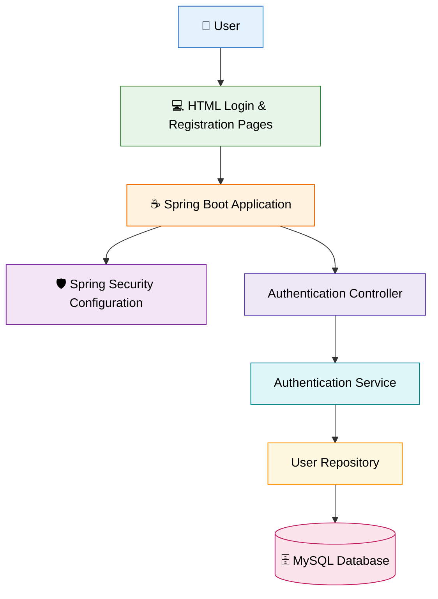

# 🛡️ BankGuard AI – Secure Banking Authentication System

**BankGuard AI** is a Java-based banking security project built with Spring Boot and MySQL. It provides a foundation for secure user authentication and banking access, with the goal of extending the system toward intelligent account-takeover detection and adaptive authentication.

## 🚀 Project Overview

As digital banking grows, protecting user accounts against unauthorized access becomes increasingly important. BankGuard AI is being developed to demonstrate how a backend authentication system can support safer banking experiences and provide a foundation for future AI-driven security features.

## ✨ Current Features

- **User Registration:** Backend support for creating user accounts.
- **User Login:** Authentication workflow for registered users.
- **Security Configuration:** Centralized Spring Security configuration.
- **Database Integration:** MySQL integration for storing application data.
- **Web Interface:** HTML pages for login, registration, and account unlocking.
- **Modular Backend:** Organized code using controllers, services, entities, and repositories.

## 🧰 Tech Stack

- **Language:** Java
- **Backend Framework:** Spring Boot
- **Security:** Spring Security
- **Database:** MySQL
- **Data Access:** Spring Data JPA
- **Frontend:** HTML
- **Build Tool:** Maven
- **Development Environment:** Visual Studio Code
- **Version Control:** Git and GitHub

## 🏗️ Project Structure

```text
BankGuard-AI/
├── src/
│   ├── main/
│   │   ├── java/com/example/demo/
│   │   │   ├── config/
│   │   │   ├── controller/
│   │   │   ├── entity/
│   │   │   ├── repository/
│   │   │   ├── service/
│   │   │   └── DemoApplication.java
│   │   └── resources/
│   │       ├── static/
│   │       └── application.properties
│   └── test/
├── pom.xml
├── mvnw
├── mvnw.cmd
└── README.md
```
## 🏛️ System Architecture

The following diagram illustrates the main components of BankGuard AI and their conceptual relationships.



### Architecture Components

- **User Interface:** HTML pages for login and registration.
- **Spring Boot Application:** Handles backend application logic.
- **Spring Security:** Provides the application's security configuration.
- **Authentication Controller:** Handles authentication-related requests.
- **Authentication Service:** Contains authentication-related business logic.
- **User Repository:** Manages database access.
- **MySQL Database:** Stores application data.

*Note: This is a conceptual architecture based on the current project structure. The actual request flow and implemented security behavior should be verified against the source code.*

## 📸 Application Screenshots

### Login Page


### Registration Page


### Unlock Page


## ⚙️ Getting Started

### Prerequisites

Install the following before running the application:

- Java JDK compatible with the project configuration
- MySQL Server
- Git
- Visual Studio Code or another Java IDE

### 1. Clone the Repository

```bash
git clone https://github.com/samruddhiauty02/BankGuard-AI.git
cd BankGuard-AI
```

### 2. Create the Database

Open MySQL and execute:

```sql
CREATE DATABASE bankguard;
```

### 3. Configure Database Credentials

The application reads its database configuration from environment variables. Set the following in your terminal, replacing the example username and password with your own local MySQL credentials.

**Windows PowerShell:**

```powershell
$env:DB_URL="jdbc:mysql://localhost:3306/bankguard"
$env:DB_USERNAME="root"
$env:DB_PASSWORD="your_local_mysql_password"
```

Keep real credentials private. Never commit passwords or secret keys to GitHub.

### 4. Run the Application

In the project directory, run:

```powershell
.\mvnw.cmd spring-boot:run
```

Wait for Spring Boot to finish starting. Check the terminal for errors and confirm the application has started successfully.

### 5. Open the Application

Use the local address and port configured by the application. If it starts on the default Spring Boot port, open:

```text
http://localhost:8080
```

The exact page and available endpoints depend on the application's current controller and frontend configuration.

## 🔮 Future Enhancements

Planned improvements for BankGuard AI include:

- AI/ML-based account-takeover risk scoring
- Detection of suspicious login patterns
- Adaptive authentication based on risk
- Login activity monitoring and audit logs
- Security alerts for unusual activity
- A dashboard for authentication and risk insights
- Automated unit and integration testing

These are future goals and will be documented as they are implemented and tested.

## 🎯 Project Objective

To develop a modular banking authentication system using Java, Spring Boot, and MySQL, while progressively exploring intelligent security mechanisms for detecting suspicious account activity.

## 👩‍💻 Author

**Samruddhi Auty**

Computer Engineering Graduate | Java | Spring Boot | SQL | Data Analytics

## 📌 Project Status

**In Development** — the project is being built incrementally, with additional security and intelligent detection features planned for future releases.

---

If you find this project interesting, feel free to explore the code and follow its development.