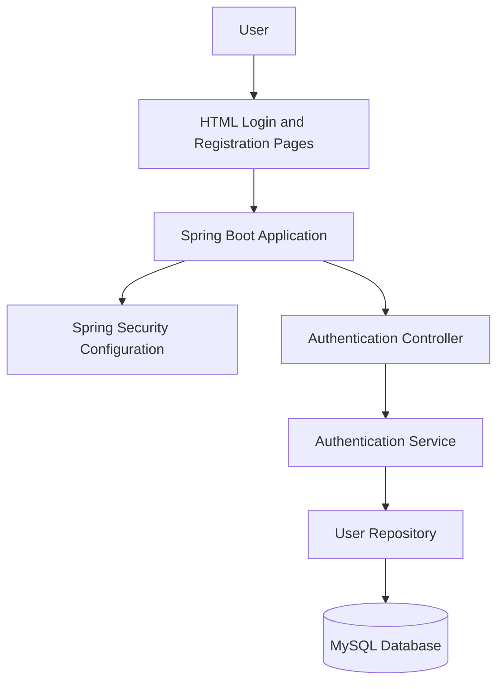

# BankGuard AI – System Architecture

## Architecture Overview

- **User Interface:** HTML pages provide the login and registration interfaces.
- **Spring Boot:** Handles backend application logic.
- **Spring Security:** Provides the security configuration for the application.
- **Authentication Controller:** Receives authentication-related requests.
- **Authentication Service:** Contains the relevant application service logic.
- **User Repository:** Provides the database access layer.
- **MySQL:** Stores application data.

*Note: This is a conceptual diagram based on the current project structure. Confirm the actual request flow and security implementation against the source code before treating every connection as implemented.*